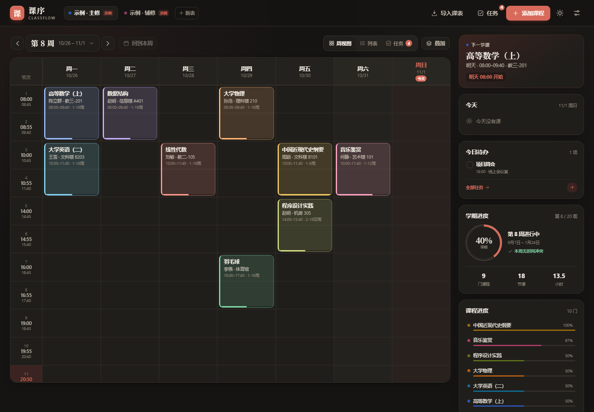
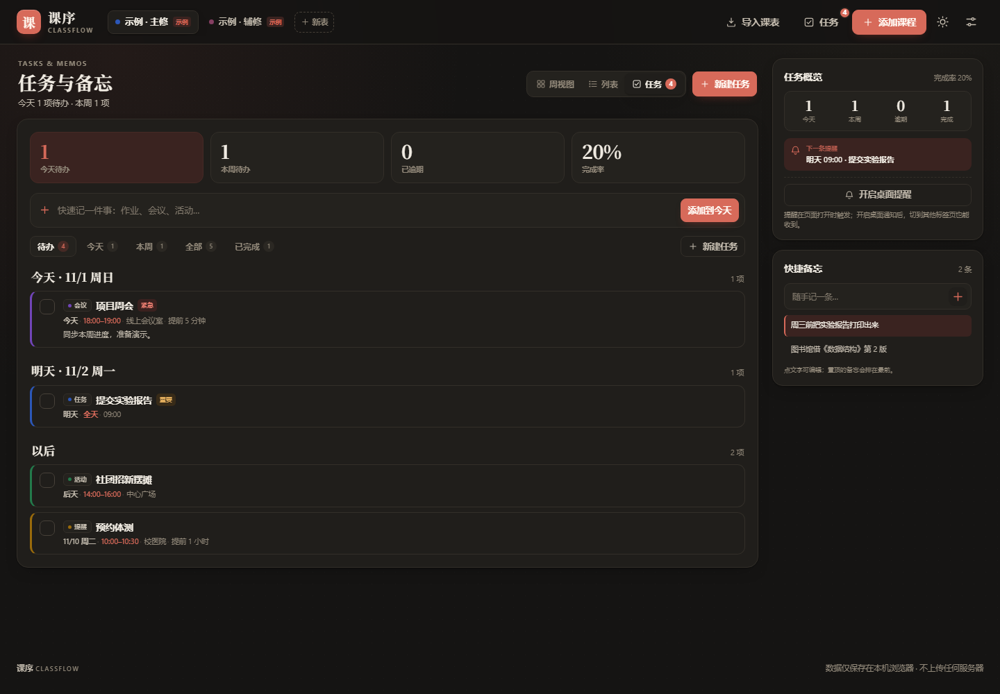

# 课序 ClassFlow

一个**本地优先**的课程表 + 任务备忘网页：不用安装、不用登录、没有后端，打开即用。课程、周次、节次时间、教师地点、进度、多张课程表，以及活动会议、待办、备忘和提醒，都保存在本机浏览器里。





## 在线访问

- 在线版：<https://tian-yuze.github.io/classflow/>
- 源码仓库：<https://github.com/tian-yuze/classflow>
- 网站简介：[SITE-INTRO.md](SITE-INTRO.md)

GitHub Pages 直接托管 `main` 分支根目录，纯静态，没有构建步骤。

## 快速开始

任选一种：

1. 双击 `index.html`（推荐 Edge / Chrome）。
2. 双击 `start-classflow.bat`。
3. 在本目录启动一个本地服务器，再访问 `http://127.0.0.1:8765`：

   ```bash
   python -m http.server 8765
   ```

首次打开会自动放两张示例课程表：「示例 · 主修」和「示例 · 辅修」，可以直接查看效果。示例表可以在「设置 → 课程表 → 删除这张课程表」中删掉，或者导入自己的课表后忽略。

## 功能

- **周视图 / 列表视图 / 任务视图**：7 天 × 最多 24 节，自动标出今天；时间列和表头滚动时保持可见。任务视图按逾期、今天、明天、本周稍后、以后、已完成分组。
- **从教务系统导入**：粘贴网页 HTML、上传 Excel / CSV / HTML、书签一键抓取，导入前逐条核对。
- **多表叠加**：把几张课程表放在同一个网格里检查冲突；也可以合并成一张新表持久保存。
- **12 种课程颜色**：同一门课复用同一颜色，自动避开已用颜色。
- **完整课程信息**：日期、周次、起止节次、教师、地点、备注、自动 / 手动进度。
- **任务与会议**：任务 / 会议 / 活动 / 考试 / 提醒五种类型，支持优先级、日期、起止时间、地点、备注和完成状态；时间留空即为全天。
- **备忘速记**：随手记想法、网址、要买的东西，支持置顶、编辑和删除。
- **待办提醒**：可设置开始时 / 提前 5–120 分钟 / 提前 1 天提醒；页面打开时用站内 Toast，授权后同时发桌面通知。
- **学期与作息设置**：第一周周一、总周数、每周显示天数、每节起止时间，全部可改。
- **课程进度**：按周次和当前时间自动计算，也可以手动填 0–100% 覆盖。
- **本地优先**：数据只存 `localStorage`，不上传服务器；支持 JSON 备份恢复和 `.ics` 日历导出。
- **深色 / 浅色 / 跟随系统**，手机端自适应，打印时自动隐藏操作界面。

## 从教务系统导入

> 出于登录态、跨域和反爬限制，网页不能直接“输入一个教务系统网址就自动抓取”。课序采用更稳的方式：把已登录页面里的课表数据抓下来，再解析。

### 方式 A：复制教务系统网页（最通用）

1. 登录教务系统，打开「我的课表 / 学期课表」页面。
2. 等课表完整加载后，按 `Ctrl+A` 全选，再按 `Ctrl+C` 复制。
3. 打开课序，点顶部「导入课表」。
4. 在导入弹窗里直接按 `Ctrl+V`。检测到 HTML 表格会自动解析；如果浏览器只给了纯文本，会按文字课表尝试解析。
5. 核对预览表格里的课程、教师、地点、星期、节次、周次，勾选要导入的课程。
6. 选择「新建课程表」或「合并到当前」，确认导入。

如果直接粘贴不完整，可以在教务系统页面按 `Ctrl+S` 把网页另存为 `.html`，再用「选择文件」上传。

### 方式 B：书签抓取

1. 打开课序的「导入课表」弹窗。
2. 把弹窗里的「课序抓取」链接拖到浏览器书签栏。它是一个 `javascript:` 书签。
3. 回到教务系统课表页，点这个书签。页面里符合条件的表格会被收集成 JSON 并尝试复制到剪贴板。
4. 回到课序的导入框按 `Ctrl+V` 粘贴。

如果浏览器禁止了剪贴板写入，书签会打开一个新窗口显示数据，手动全选复制即可。

### 方式 C：Excel / CSV 文件

「选择文件」支持：

- `.xlsx`（推荐）
- `.csv` / `.tsv`
- `.html` / `.htm`（网页另存为）
- `.json`（书签抓取得到的文件）
- 旧版 `.xls` 请先用 Excel 另存为 `.xlsx`

Excel 建议使用一张简单的表，第一行是表头。列名可以是：

```text
课程名称,教师,地点,星期,节次,周次,备注
高等数学,陈立群,教三-201,周一,1-2节,1-16周,
大学英语,王雪,文科楼 B203,周一,3-4节,1-16周,含听力
程序设计实践,赵明,机房 305,周五,5-6节,2-16周(双),
```

周次支持：

- `1-16周`
- `1-15单周`
- `2-16双周`
- `1,3,5,7周`
- `1-8,10-16周`

在导入弹窗里也可以直接点「CSV 模板」下载一份带 BOM 的模板，用 Excel 打开填写。

### 方式 D：手动录入

点顶部「添加课程」，或直接点周视图里的空白格（会自动带入星期和节次）。课程表单里可以设置：

- 课程名称、教师、地点
- 星期、起止节
- 周次（支持「全部周 / 单周 / 双周 / 清空」快捷按钮）
- 课程颜色
- 手动进度（留空 = 自动）
- 备注

保存时会检查周次是否超出总周数；如果和同表课程时间重叠，会二次确认，保存后重叠课程并排显示并标冲突。

## 任务、备忘与提醒

顶部「任务」进入任务视图，或者从右侧栏的今日待办进入。

### 任务

- 点「新建任务」或「快速记一件事」添加；任务支持类型（任务 / 会议 / 活动 / 考试 / 提醒）、优先级（普通 / 重要 / 紧急）、日期、起止时间、地点、备注。
- 时间是可选的：不填开始时间就是「全天」；只填开始时间也可以。
- 在任务左侧复选框上勾选完成；已完成的任务会进入「已完成」筛选，可以再次取消完成。
- 筛选栏包括待办、今天、本周、全部、已完成；任务会按逾期、今天、明天、本周稍后、以后、已完成分组。
- 点击任务主体可以编辑或删除；按日期和时间排序。
- 右侧栏在任务页显示「任务概览」和「快捷备忘」；回到课程页时，右侧栏也会显示今天的待办。

### 备忘

- 在任务视图右侧「快捷备忘」输入框里直接写，回车或点加号添加。
- 点击备忘文字可以编辑，右侧图钉可以置顶；置顶备忘排在前面。
- 备忘是纯文本，最多 1000 字；和课程/任务一起保存在本地。

### 提醒

- 新建或编辑任务时选择提醒时间：开始时、提前 5 / 10 / 15 / 30 / 60 / 120 分钟、提前 1 天。
- 全天任务默认在当天 09:00 触发提醒；有开始时间的任务从开始时间倒推。
- 页面打开期间，到点会弹站内 Toast；点右侧栏「开启桌面提醒」并允许浏览器通知后，还会发送系统通知。
- 提醒状态写入本地数据（`remindedAt`），刷新页面不会重复提醒已经触发过的任务。
- 浏览器通知需要安全上下文（`https://` 或 `localhost`）；直接以 `file://` 打开时可能无法授权。页面关闭后不会推送，这是纯静态网页的限制。

## 多表叠加与合并

- 顶部「叠加」：勾选其他课程表，在同一张网格里查看。叠加**只影响查看**，不会改数据；菜单里的「冲突」可以查看当前周所有重叠。
- 叠加弹窗底部「合并为新课程表」：把当前表和勾选的表真正合并成一张新表，原表保留。合并会按「课程名 + 星期 + 起止节 + 周次」去重，并自动扩展总周数和显示天数。

## 设置

「设置 → 课程表」：

- 课程表名称
- 第一周周一（决定第 N 周对应的日期）
- 总周数（1–30）
- 每周显示天数（5 / 6 / 7 天）
- 作息时间：每节的开始 / 结束时间，可添加或删除；删除正在被课程使用的节次会被阻止
- 删除当前课程表（至少保留一张）

「设置 → 通用」：

- 主题：跟随系统 / 浅色 / 深色
- 任务提醒：查看/申请浏览器桌面通知权限
- 导出 JSON 备份、恢复备份
- 导出 `.ics` 日历（课程按周生成，任务生成带 `VALARM` 的日程，使用本地浮动时间）
- 清空全部数据（会重新放回示例表，并清空任务和备忘）

## 数据与备份

- 存储位置：当前浏览器的 `localStorage`，键名 `classflow.state.v1`。
- 保存内容：课程表、节次时间、任务、备忘、主题和提示状态。
- 换浏览器、换电脑、清理浏览器数据都会丢失，请用「导出 JSON 备份」。
- 恢复备份会覆盖当前全部课程表、任务和备忘，恢复前会二次确认。
- 数据不会发送到任何服务器。

## 适配你学校的教务系统

课序的解析器是通用的：它能处理常见的 HTML 表格（含 `rowspan` / `colspan`）、列表型课表、CSV 和简单 Excel。但不同学校差异很大，尤其是：

- 课表在 iframe 里
- 课表是 Canvas / 图片 / 自定义组件
- 周次写在课程名里，或使用「1-16周(单)」等特殊格式
- 页面需要登录、验证码或动态令牌

如果导入效果不理想，可以给我：

1. 教务系统名称 / 学校名称
2. 课表页面的 HTML（另存为文件，或复制源码）
3. 一张课表截图和课程实际周次

拿到这些就可以针对你的系统加适配规则。

## 项目结构

```text
index.html                 页面骨架、图标 sprite
assets/css/style.css       设计系统、布局、响应式、打印样式
assets/js/utils.js         日期、周次、格式化、下载等工具
assets/js/data.js          数据模型、存储、示例数据、任务/备忘、合并、ICS
assets/js/parse.js         网页 / CSV / XLSX / 书签解析
assets/js/render.js        纯渲染：周视图、列表、任务、侧栏、提示条
assets/js/ui.js            弹窗、确认框、Toast、剪贴板
assets/js/app.js           状态、事件、表单、导入、设置、提醒
preview.png                课程表预览图
preview-tasks.png          任务与备忘预览图
SITE-INTRO.md              可直接用于发布/介绍的网站简介
test/                      开发自测脚本与导入样例
```

## 浏览器与已知限制

- 推荐最新版 Edge / Chrome；`file://` 直接打开已测试可用。Safari 对 `DecompressionStream` 的支持取决于版本，XLSX 导入可能不可用。
- 任务提醒只在页面打开时检查（每 20 秒一次），页面关闭或系统休眠后不会补发；桌面通知还需要浏览器授权。
- 最多 24 节课、30 周；移动端周网格横向滚动。
- 不支持直接抓取需要登录的 URL；请用复制 / 书签 / 文件导入。
- 不支持旧版 `.xls`、PDF、图片 OCR。
- `.ics` 使用本地浮动时间，不写入时区；导入日历后如时间有偏移，请在日历端调整时区。
- 课程进度是“按周次 + 节次结束时间”的估算，不处理调休、停课和补课。

## 开发自测

需要本地服务器 `http://127.0.0.1:8765` 和 Edge。测试脚本里的 Edge 路径按当前 Windows 环境写死，换机器时请改脚本顶部常量。

```bash
node test/cdp.mjs       # 课程表主流程冒烟测试（会生成截图）
node test/extra.mjs     # 设置节次、课程编辑删除、合并导入、文件上传测试
node test/parsers.mjs   # XLSX / HTML / ICS / 书签 / file:// 测试
node test/tasks.mjs     # 任务、备忘、提醒、通知、ICS 与移动端测试
```

`test/fixtures/` 里有可以直接用来试导入的 `sample.xlsx` 和 `sample-timetable.html`。
